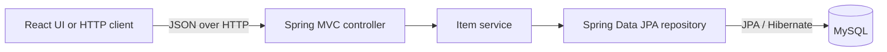

# Backend architecture

## Scope

This project is a Java Spring Boot REST API backed by MySQL. It manages catalog items, reorder levels, and a stock-movement audit trail for the React frontend.

## Technology flow

## Responsibilities

- **Controller:** exposes catalog, dashboard, quantity-update, and movement-history endpoints; validates requests and returns HTTP responses.
- **Service:** lists items in name order, rejects duplicate names without case sensitivity, saves valid items, calculates low-stock data, updates stock quantities, and records stock movements.
- **Repository:** uses Spring Data JPA to query and save `Item` and `StockMovement` records.
- **MySQL:** stores item data beyond the lifetime of the application process.
- **DTOs:** define the JSON request and response shapes independently of the persistence entity.

## Catalog flows

The product page loads the catalog with `GET /api/items`. To create an item, the client sends a name, optional description, starting quantity, and reorder level as JSON to `POST /api/items`. Inventory stock is set with `PUT /api/items/{id}/quantity` and a non-negative whole number; changed quantities create a timestamped movement record. The overview page loads `GET /api/dashboard` for live metrics, low-stock products, and recent activity.

1. Jakarta Bean Validation rejects a blank name.
2. The service checks for an existing name.
3. If the name exists, the API returns `409 Conflict` with code `ITEM_ALREADY_EXISTS` and a readable message.
4. Otherwise, Spring Data JPA saves the item in MySQL and the API returns `201 Created`.

## Configuration

The MySQL URL, username, and password are read from `DB_URL`, `DB_USERNAME`, and `DB_PASSWORD`. Local defaults are provided in `application.properties`; use environment-specific credentials outside local development. Hibernate schema auto-update is enabled for this starter project. A production deployment should use a managed schema migration process before it is exposed to users.
